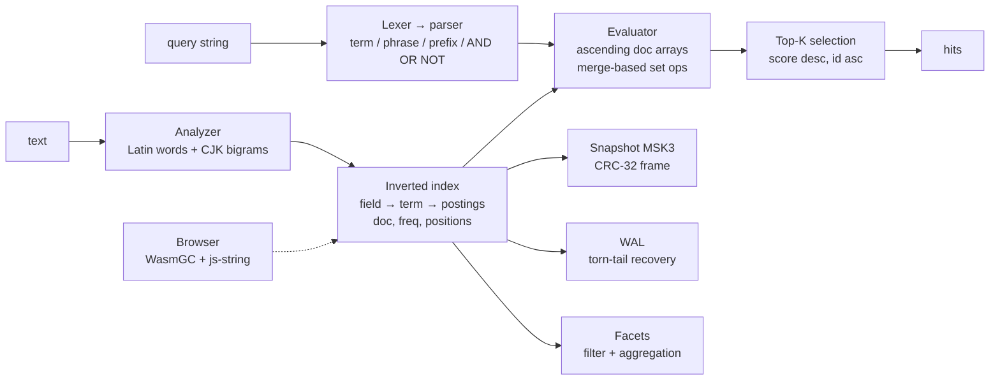

# moonseek

**A search platform in pure MoonBit: embeddable library, HTTP service, and horizontally scalable cluster.** Inverted index, BM25, dictionary-free Chinese tokenization, fuzzy search, facets, numeric aggregations, HNSW vector search, hybrid fusion — plus an HTTP search service and a distributed coordinator with scatter-gather, globally consistent scoring, replication, failover, online rebalancing, replica repair and cross-shard hybrid retrieval. Runs on native, WebAssembly and JavaScript.

纯 MoonBit 实现的搜索平台：既是嵌入式库，也是 HTTP 检索服务，还是可水平扩展的集群（一致性哈希、写入复制、在线扩容、副本自愈）。倒排索引、BM25、免词典中文分词、模糊搜索、分面过滤、服务端高亮、WAL 崩溃恢复，支持 native / WASM / JS 三端。

**▶ Live demo: [naiwaniubi.github.io/moonseek](https://naiwaniubi.github.io/moonseek/)** — searches **all 3,698 packages on mooncakes.io** in your browser. No server, no network requests after load. Also: drop your own files in and index them live, and read the measured quality/ablation report.

[](https://github.com/NaIWaniubi/moonseek/actions/workflows/ci.yml)
[](LICENSE)
[](https://mooncakes.io/packages/NaIWaniubi/moonseek)
[](#testing)


## Why moonseek

MoonBit's ecosystem has HTTP servers, crypto and database drivers — but no tantivy/Lucene-class embedded search engine. moonseek fills that gap with a single dependency-light library that works everywhere MoonBit compiles, including **inside the browser via WasmGC**.

## Features

- **Inverted index** with per-field weights (e.g. title ×3, body ×1)
- **BM25 ranking** with configurable `k1` / `b`
- **Chinese + English tokenization**: Latin words with stop-word removal; CJK overlapping bigrams (Lucene CJKAnalyzer strategy) — no dictionary needed
- **Rich query syntax**: `term`, `"exact phrase"`, `"a b"~3` (sloppy phrase: up to 3 tokens between terms), `AND` / `OR` / `NOT`, `field:term`, `prefix*`, parentheses, implicit AND
- **Fuzzy search**: Levenshtein / Damerau-Levenshtein edit distance with early-exit bounded DP; **BK-tree** for sub-linear lookup (13–1780× faster than linear scan on a 24k-term vocabulary)
- **Did-you-mean**: frequency-weighted spelling correction (`suggest`)
- **Faceted search**: exact-match facet fields, AND/OR filters, per-facet value counts, offset pagination (`search_faceted`)
- **Ranking control**: configurable sort — score, id, or a numeric field, in either direction, over HTTP as `sort=num:year&order=desc` and in the library as `search_sorted`; cursor pagination (`search_after`); per-term BM25 breakdown (`explain`). A cross-shard numeric sort is exact: the shards ship the key
- **Server-side highlighting**: `highlight` / `snippet` with HTML escaping, CJK-aware codepoint spans, overlap merging, densest-window extraction
- **Stored fields**: original texts kept in the index, retrievable via `get_document` / `get_field`, survive snapshots
- **Segmented index**: immutable segments + tiered merge policy + cross-segment search with latest-version-wins (`SegmentedIndex`)
- **Write-ahead log**: CRC-framed entries, torn-tail recovery, durable add + atomic checkpoint + crash-safe reopen (native)
- **Crash-safe persistence**: versioned snapshot + CRC-32 checksum; atomic save (temp file → fsync → rename); torn/corrupt files are rejected, never silently loaded
- **Portable**: pure MoonBit core (no FFI in the engine); native file store via `moonbitlang/async`; browser export via WasmGC + js-string builtins. **One snapshot format, two backends**: an index built by the native binary loads byte-for-byte into the browser's wasm-gc build
- **Measured quality, not just latency**: NDCG@10 / MRR@10 / Recall@20 over 3,698 real packages with a 6-way ablation ([docs/quality.md](docs/quality.md))
- **HTTP service**: a REST search API (`docs/api.md`) with bulk ingest, facets, aggregations, highlighting, `explain`, suggest and vector queries. The console in `console/` drives it
- **Durable service**: `--data-dir` journals every accepted write (CRC-framed, data fsync) before applying it and checkpoints atomically, so a restart replays text, facets, numbers, vectors and deletions exactly. One fsync per bulk batch keeps durable ingest within ~1.2–1.3× of in-memory; `tools/test-durability.sh` restarts the process to prove it
- **Distributed cluster**: one binary is a node, a shard or a coordinator. **Consistent hashing** (a fourth shard moves 24% of the corpus, not 75%), **write routing with replication to every group member**, **cross-shard facets, aggregations, sorts and hybrid retrieval that equal a single node**, **globally consistent scoring** (`?dfs=true` reproduced a single node's ranking exactly, 8/8 queries, zero score difference), **`POST /_rebalance` to grow without a reindex** (the plan predicted 762 moves and the executor made 762, ending at exactly the predicted distribution), **`POST /_repair` to bring a member that missed writes back in line**, replica failover, and partial answers that name the shards that failed ([docs/cluster.md](docs/cluster.md))
- **Vector search**: pure-MoonBit HNSW with **measured recall** against brute force (0.996@ef=32, 0.999@ef=64 on 1,000 random 32-d points), plus hybrid BM25 × kNN fusion by reciprocal rank
- **Numeric aggregations**: terms, stats, histogram and percentiles over a result set, with numeric doc values alongside facets
- **Document lifecycle**: add, replace (same id), delete

## How it works



## Three ways to run it

**1. Embedded** — the library, as above. `moon add NaIWaniubi/moonseek`.

**2. As a service** — one process, an HTTP search API and the console:

```bash
moon build server --target native --release
./_build/native/release/build/server/server.exe --addr 127.0.0.1:7700 --assets console
curl -X POST localhost:7700/index/bulk --data-binary @docs.jsonl
curl "localhost:7700/search?q=parser&facets=license"
```

Add `--data-dir ./data` to make it **survive a restart**: every accepted write is
journaled with a data fsync before it is applied, and `POST /_checkpoint` (or
every 10,000 records) snapshots atomically and truncates the journal. Text,
facets, numeric columns, vectors and deletions all come back on replay —
`tools/test-durability.sh` restarts the process to prove it. Without the flag the
server is in-memory only and says so (`/_checkpoint` returns 400).

**3. As a cluster** — three shards and a coordinator that owns no data:

```bash
for k in 0 1 2; do
  ./server.exe --addr 127.0.0.1:$((7801+k)) --shard-port 127.0.0.1:$((7901+k)) &
done
./server.exe --addr 127.0.0.1:7805 --shards "127.0.0.1:7901,127.0.0.1:7902,127.0.0.1:7903"
# ?dfs=true makes the ranking identical to a single node holding the whole corpus
curl "localhost:7805/search?q=parser&dfs=true"
```

**4. The whole thing in one command** — a replicated cluster, the corpus loaded
through the coordinator, and the console served:

```bash
tools/demo.sh          # starts it and prints the URLs
tools/demo-story.sh    # or: the full story as a script (see docs/demo-video.md)
```

`tools/demo-story.sh` walks search → `dfs` → hybrid retrieval → grow 3→4 groups
without a reindex → repair a diverged member → kill a primary (failover) → kill
its replica (honest degradation). It is the thing to screen-record, and
[docs/demo-video.md](docs/demo-video.md) is the shot list with narration.

Five end-to-end scripts run in CI: `tools/test-cluster.sh` (dfs ranking, placement
agreement, the ring's reshuffle, distributed aggregations, sorted queries,
distributed hybrid retrieval, failover, two coordinators),
`tools/test-replication.sh` (a replicated write survives the loss of its
primary), `tools/test-rebalance.sh` (grow 3 shards to 4 without reindexing), and
`tools/test-repair.sh` (a member that missed writes is brought back), and
`tools/test-durability.sh` (writes, deletes, vectors and numbers survive a
restart). To grow a running cluster:

```bash
./server.exe --addr 127.0.0.1:7805 --shards "…:7920,…:7921,…:7922,…:7923"   # after adding the new shard
curl -X POST "localhost:7805/_rebalance?from=3"
curl -X POST "localhost:7805/_repair"      # after a member comes back
```

`tools/check-cluster.mjs` runs the cluster-vs-single-node comparison and prints
the identity and latency tables in [docs/cluster.md](docs/cluster.md). Ask a
coordinator where a document lives with `GET /_placement?id=…`, and what a
grow-out would cost with `GET /_plan?shards=4`.

## Quick start

```moonbit nocheck
let index = @moonseek.Index::new([
  { name: "title", weight: 3.0 },
  { name: "body", weight: 1.0 },
])

index.add({
  id: "doc1",
  fields: [
    ("title", "全文搜索引擎"),
    ("body", "倒排索引是搜索引擎的核心，BM25 负责排序。"),
  ],
})
index.add({
  id: "doc2",
  fields: [("title", "MoonBit"), ("body", "A fast language for WebAssembly")],
})

let hits = index.search("搜索引擎")        // [{ id: "doc1", score: … }]
let hits2 = index.search("title:moonbit")  // field-scoped
let hits3 = index.search("\"memory safety\" OR wasm*")  // phrase + prefix

// Persist (native)
index.save("index.msk")
let restored = @moonseek.Index::load("index.msk")

// Or portable bytes (works on every backend)
let image : Bytes = index.to_bytes()
let restored2 = @moonseek.Index::from_bytes(image)
```

## CLI

```bash
moon run cmd/main -- index ./docs --index index.msk   # index .txt/.md files
moon run cmd/main -- search "搜索引擎" --index index.msk
moon run cmd/main -- search "title:rust" --limit 5
moon run cmd/main -- info --index index.msk
```

## Browser demo

A complete search engine running inside your browser — no server, no network:

```bash
moon build --target wasm-gc
cp _build/wasm-gc/debug/build/web/web.wasm demo/web.wasm
cd demo && python -m http.server 8000
# open http://localhost:8000 (Chrome / Edge with WasmGC + js-string builtins)
```

The demo does three things, all in the browser:

1. **Searches the real registry.** Every one of the **3,698 packages published on mooncakes.io** (22,837 versions) is indexed — package names, author-written keywords, descriptions, and dependency edges. The index is built by the *native* binary into a 1.37 MB `MSK3` snapshot and loaded by the *wasm-gc* build, which is the strongest evidence that the format is portable. Loading takes ~200 ms; the median query over a 12-query mix is **0.20 ms**.
2. **Indexes your own files.** Drag in `.txt` / `.md` / `.json` / `.csv` / `.log` files (or paste text) and they are parsed, tokenized and searchable immediately, with the whole index persistable to IndexedDB as one snapshot blob and reloadable without re-parsing.
3. **Shows its own quality.** A live benchmark measures query-latency percentiles and the latency-vs-index-size curve in your browser, next to the ablation table from `tools/eval`: the same corpus and queries under six scoring configurations, so you can see which mechanism is worth how much NDCG.

Results use **server-side highlighting** (the WASM engine produces escaped HTML with CJK-aware `<mark>` spans), misspelled queries get **did-you-mean suggestions** and **fuzzy fallback**, and every hit can expand into its **BM25 score breakdown**.

## Performance

`moon bench --target native --release`, 1000 synthetic documents (~80 tokens each), AMD Ryzen 7 7435H:

Small corpus (`moon bench`, 1000 synthetic docs, mean +/- sigma):

| Operation | Time |
|---|---|
| Index 1000 docs (with stored fields) | 85.8 ms +/- 6.2 |
| Term query (top-10) | 262 us +/- 12 |
| Phrase query (top-10) | 1.01 ms +/- 0.24 |
| Snapshot save + load | 45.3 ms +/- 2.7 |

Stress test (`bench/stress`, 20,000 docs / 8.57 MB text / 23,782 terms, release). Build is the
median of 4 timed runs; queries are p50 of 200 samples, `limit=10`:

| Operation | Time |
|---|---|
| Index build | 2.73 s -> **7,320 docs/s** (median of 4) |
| Selective term (df 285) | **0.06 ms** |
| Field-scoped term (df 732) | 0.13 ms |
| Saturated term (df 4,021) | **0.36 ms** with block-max (see below) |
| Chinese bigram (df 4,113) | 0.37 ms |
| Boolean query | 3.02 ms |
| Exact phrase | 6.25 ms -> **0.29 ms** (rarest-term walk, ~24x) |
| Sloppy phrase `"a b"~3` | 9.80 ms -> **1.04 ms** (~9x) |
| Prefix query `seg*` | 2.34 ms -> **0.44 ms** (one term -> block-max) |
| Facet filter + aggregation (3,055 matches) | 14.0 ms |
| Fuzzy lookup, 23.8k terms | linear 37-46 ms -> **BK-tree 0.07-2.7 ms** (17-491x) |
| Snapshot 17.6 MB: serialize / load | 0.68 s / 0.75 s |

**Block-max WAND** on a bounded query that is a single term, a conjunction, or a
disjunction with a wide document-frequency spread: the doc-sorted postings are
walked in blocks of 16 and, once the top-`k` is full, a block is skipped when its
highest reachable score is below the k-th best. A conjunction additionally drives
on its **shortest** term, so a saturated term is never enumerated. On the corpus
above this skips 70–74% of the postings: a single saturated term drops from
~2.0 ms to **0.92 ms (2.2×)** and `search AND engine` from ~4.3 ms to **2.7 ms**.
A disjunction takes the walk only when a dense operand sets the threshold and a
much rarer one creates the gap — `search OR <4 rare terms>` is then 29% faster
and skips 75% of the postings — because otherwise the plain merge wins; the gate
(`or_walk_pays`), its measurements and the tests pinning both sides are in
[docs/benchmark.md](docs/benchmark.md). Everywhere the result is bit-for-bit the
full scan, because a block is skipped only on a *strict* inequality (a tie is
still scored, so it can still win the id tiebreak) and the tests assert the
equality, including a corpus with a huge tie group on the cut.

Browser (WasmGC, the 3,698-package registry snapshot): 206 KB binary, snapshot load ~200 ms, median
query **0.20 ms**, p90 0.2-0.3 ms, snapshot export ~200-315 ms.

Full methodology, per-shape ranges and an explicit list of what is *not* measured:
[docs/benchmark.md](docs/benchmark.md).

## Architecture

```
token.mbt      Analyzer: Latin words + CJK bigrams, positions
index.mbt      Inverted index, field stats, BM25, stored fields
query.mbt      Lexer → recursive-descent parser → evaluator
fuzzy.mbt      Levenshtein/Damerau distance, fuzzy search
suggest.mbt    Frequency-weighted did-you-mean
highlight.mbt  Server-side highlight/spans/snippet (codepoint offsets)
facet.mbt      Facet values, filters, aggregations, pagination
bktree.mbt     BK-tree for sub-linear fuzzy lookup
explain.mbt    BM25 breakdown, sort orders, cursor pagination
segment.mbt    SegmentedIndex: immutable segments + tiered merge
wal.mbt        CRC-framed write-ahead log (portable byte layer)
wal_native.mbt Durable add/checkpoint/crash recovery (native)
codec.mbt      Varint / UTF-8 / double / CRC-32 primitives
snapshot.mbt   MSK3 format: versioned payload + checksum + stored fields + facets
store.mbt      Native atomic file persistence (async/fs)
web/           Browser exports (#export_name, js-string builtins)
cmd/main/      CLI: index / search / info
examples/      Runnable examples (basic, persistence)
demo/          Single-page browser demo (60 docs, benchmarks, inspector)
```

See [docs/architecture.md](docs/architecture.md) for design details and the snapshot format specification.

- [docs/benchmark.md](docs/benchmark.md) — performance whitepaper (stress numbers, methodology, limitations)
- [docs/comparison.md](docs/comparison.md) — feature matrix vs tantivy / Lucene / bleve

## Testing

```bash
moon test                    # 299 tests (native)
moon test --target wasm-gc
moon test --target js
moon bench --release         # benchmarks
moon coverage analyze        # coverage report
moon run bench/stress --target native --release   # 20k-doc stress benchmark
```

Tests cover tokenization, boolean/phrase/prefix/fuzzy queries, BM25 ordering, spelling correction, highlighting spans and HTML escaping, segment merge correctness, WAL torn-tail recovery, snapshot roundtrips, corruption/truncation detection, crash-safe file persistence, and quickcheck properties (roundtrip, varint, positions, delete exclusion).

## Roadmap

- [x] Segment merging & incremental indexing
- [x] Result highlighting API
- [x] Fuzzy / edit-distance queries
- [x] Did-you-mean spelling correction
- [x] Write-ahead log with crash recovery
- [x] Faceted search & aggregations
- [x] BK-tree accelerated fuzzy matching
- [x] Score explanation, sort orders, cursor pagination
- [x] Merge-based evaluator over ascending doc arrays (no per-query score map)
- [x] Distributed sharded search: consistent hashing, write replication,
      cross-shard aggregations, failover
- [ ] Rebalancing executor and coordinator election (see the list in
      [docs/cluster.md](docs/cluster.md))

## License

Apache-2.0. Built for the MoonBit open-source ecosystem.